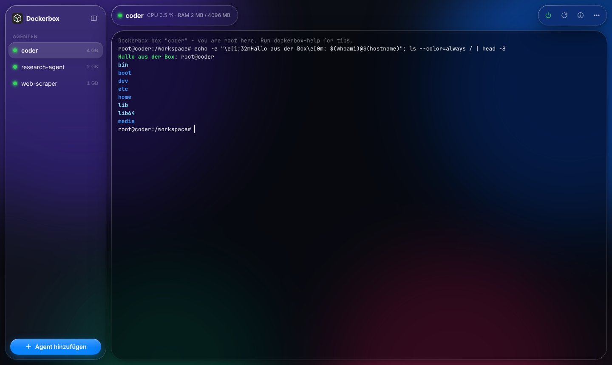
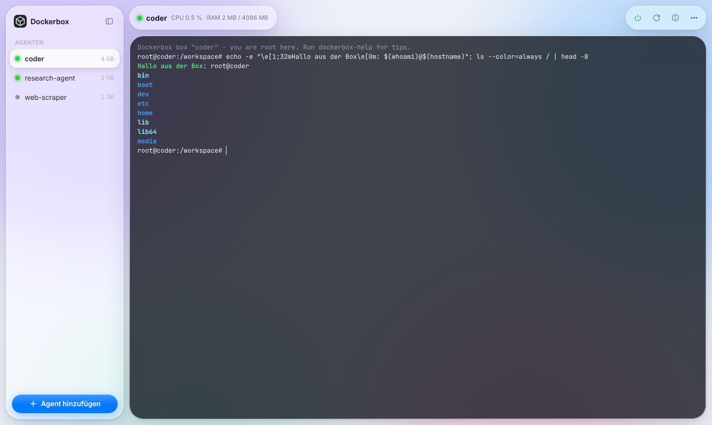
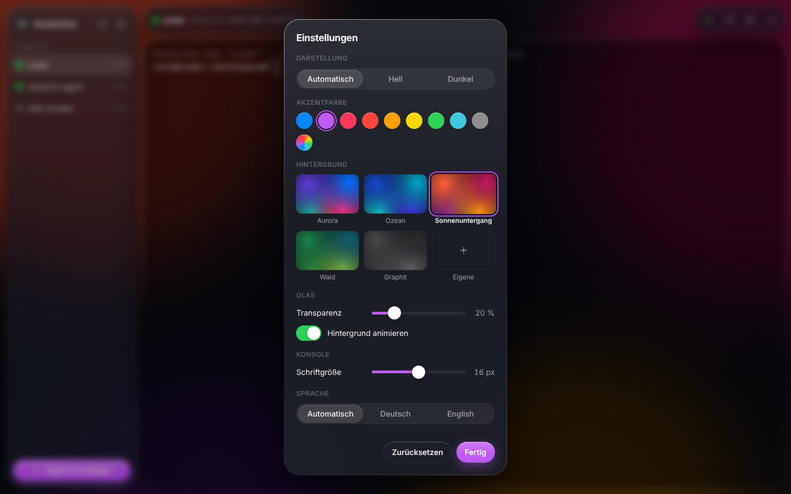

<p align="center"></p>

<h1 align="center">Dockerbox — AI Agent in a Box</h1>

<p align="center">
Run AI agents with full root rights inside lightweight, isolated Linux boxes —<br>
one box per agent, managed from a web dashboard, without the overhead of VMs.
</p>

<p align="center">
<a href="README.de.md">Deutsch</a> ·
<a href="docs/zimaos.md">Install on ZimaOS</a> ·
<a href="docs/architecture.md">Architecture</a> ·
<a href="docs/security/threat-model.md">Security</a>
</p>



<p align="center">


</p>

## Why

AI coding and research agents work best when they can `apt install`, start
services and change the system freely. Giving them that on your home server is
dangerous; running a full VM per agent is heavy for small boards like a ZimaBoard.

Dockerbox gives each agent its **own Linux box** in which it is `root`, while the
box itself is locked down:

| Inside the box | Outside the box |
|----------------|-----------------|
| root, `apt`, `pip`, `npm`, services, tmux | no Docker socket, no privileged mode, no host mounts |
| Internet via HTTP(S) proxy | no access to the host, the LAN or other agents |
| persistent `/root` and `/workspace` | hard memory, CPU and process limits |

An idle box costs **< 1 MiB of RAM**. The management services together use about
30 MiB.

## Features

* Glass-style dashboard (light and dark) with an agent list, power button and a live console per agent (xterm.js)
* Personalisation: accent colour, background, glass transparency, console font size, language — saved on the server, so every device looks the same
* Start, shut down, restart, re-create from a newer image, delete (with or without data)
* Persistent `tmux` session: close the browser, the agent keeps working
* Pop-out console windows, multiple windows can watch the same session
* Per-agent resource limits, clamped to admin-defined maxima
* English and German UI, works on desktop, tablet and phone
* One `docker-compose.yml`, ZimaOS app metadata included, `amd64` and `arm64`

**No AI agent is pre-installed** — the box is a plain Debian console. Install the
agent of your choice inside it (run `dockerbox-help` in the console for hints).
Installers that register a service (`systemctl enable --now ...`) work without
manual steps: services are supervised and start again with the box.

## Quick start

```bash
curl -fsSLO https://raw.githubusercontent.com/Pyzyi/dockerbox/main/docker-compose.yml
# optional: set DOCKERBOX_PASSWORD (min. 12 characters) in docker-compose.yml
docker compose up -d
```

Open `http://<server>:8420`, log in, click **Add agent**.

If `DOCKERBOX_PASSWORD` is empty, a random password is generated on first
start and printed in the log of the `web` container:

```bash
docker compose logs web | grep password
```

On **ZimaOS** follow the [ZimaOS guide](docs/zimaos.md).

## How it works

```
Browser ─▶ web (UI, auth) ─▶ broker (only holder of docker.sock, policy) ─▶ Docker Engine
                                                                     │
           agent box ◀── own isolated network (no host IP, no route) ┘
               │
               └─▶ egress proxy ─▶ Internet   (private/LAN/host addresses denied)
```

Real Docker-in-Docker would need `--privileged`, which lets a root process escape
trivially. Dockerbox instead creates each box as a hardened *sibling* container
through a small broker that validates every container spec against a security
policy. Details: [architecture](docs/architecture.md), [ADRs](docs/adr/),
[threat model](docs/security/threat-model.md), [design audit](docs/security/design-audit.md).

## Configuration

All settings are environment variables; see [docs/configuration.md](docs/configuration.md).
The most important ones:

| Variable | Default | Meaning |
|----------|---------|---------|
| `DOCKERBOX_PASSWORD` | generated | Dashboard password (min. 12 characters) |
| `DOCKERBOX_PORT` | `8420` | Published dashboard port |
| `DOCKERBOX_MAX_AGENTS` | `10` | Maximum number of boxes |
| `DOCKERBOX_MAX_MEMORY_MB` / `DOCKERBOX_MAX_CPUS` | `8192` / `4` | Upper limits per box |
| `DOCKERBOX_EGRESS_ALLOW_CIDRS` | empty | Private targets boxes may reach, e.g. `192.168.1.50:11434` for a local LLM server |
| `DOCKERBOX_AGENT_RUNTIME` | `runc` | `runsc` (gVisor) or `sysbox-runc` for stronger isolation |

## Security notes

* Treat the dashboard like SSH access: use a strong password and do not expose
  port 8420 to the Internet. For remote access use a VPN, or an HTTPS reverse
  proxy on a **dedicated hostname** (cookies are shared by all apps on the same
  host name) with `DOCKERBOX_SECURE_COOKIE=true`.
* Use Docker Engine 26 or newer (older versions forward DNS from internal
  networks, CVE-2024-29018) and keep runc/ZimaOS updated.
* Boxes have no disk quota by default: a runaway agent can fill the Docker disk.
  Keep an eye on free space or use a storage driver with quotas.
* API keys you enter inside a box are readable by the agent in that box. Use
  dedicated keys with spending limits.
* Containers share the host kernel. Keep ZimaOS updated; use gVisor if you need a
  stronger boundary.

Report vulnerabilities privately, see [SECURITY.md](SECURITY.md).

## Development

```bash
make ui && make check   # lint + unit tests
make images && make it  # build images + integration tests (real escape attempts)
```

Quality requirements follow ISO/IEC 25010, see [docs/quality/iso25010.md](docs/quality/iso25010.md).
Contributions welcome — read [CONTRIBUTING.md](CONTRIBUTING.md).

## License

[MIT](LICENSE)
