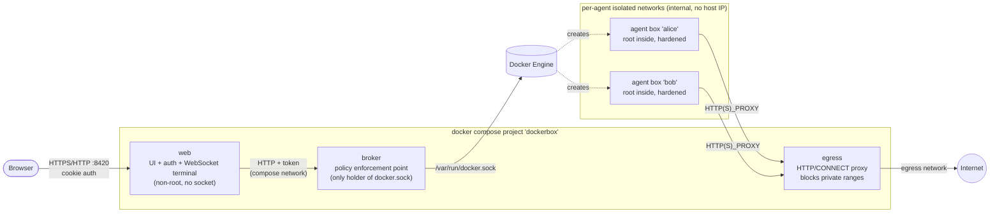

# Architecture

Dockerbox runs isolated Linux consoles ("agent boxes") for AI agents on a small
home server such as a ZimaBoard running ZimaOS. Every agent gets its own
container in which it is `root`, can install packages and use the whole OS,
but cannot reach the Docker host, the LAN or other agents.

## Goals and constraints

| # | Requirement | Source |
|---|-------------|--------|
| R1 | An agent has full admin rights **inside** its box (root, `apt install`, services). | User |
| R2 | An agent must not be able to leave its box (no host access, no Docker socket). | User |
| R3 | Several agents run side by side, each in its own box. | User |
| R4 | Lower resource usage than a VM; idle boxes cost almost nothing. | User |
| R5 | Web dashboard: "add agent" button, console window per agent. | User |
| R6 | Single `docker-compose.yml` that installs cleanly on ZimaOS. | User |
| R7 | No host modifications required (ZimaOS is a mostly immutable OS). | ZimaOS |
| R8 | No personal data in the repository; publishable as open source. | User |

## Component overview

### `web`

* Serves the dashboard (static HTML/JS, xterm.js vendored, no CDN).
* Authenticates the user (password from env/secret or generated on first start).
* Translates browser requests into a **small, high-level** broker API
  (`create agent`, `start`, `stop`, `delete`, `open terminal`, ...).
* Bridges a browser WebSocket to an interactive `tmux` session inside the box.
* Holds **no** Docker socket. A compromise of `web` therefore only gives access
  to the high-level broker API, which can only create *hardened* boxes.

### `broker`

* The only component with access to `/var/run/docker.sock`.
* Not reachable from the browser or from agents; its port is not published
  and every API call needs a random token that only `web` knows.
* Does **not** forward raw Docker API calls. It builds every container, network
  and volume definition itself from a fixed template and validates the result
  against an explicit policy (`internal/broker/policy.go`) before sending it to
  Docker. Only objects labelled `dockerbox.managed=true` for the own instance
  can be inspected, changed or deleted.
* Reconciles the egress proxy's network attachments on start and periodically.

### `egress`

* Small forward proxy (HTTP + `CONNECT`).
* Resolves the destination itself and dials the *checked* IP address
  (prevents DNS rebinding), denies loopback, RFC 1918, link-local, CGNAT,
  ULA, multicast, documentation and other special-purpose ranges.
* Optional allow-list (`DOCKERBOX_EGRESS_ALLOW_CIDRS`) for deliberate LAN
  services such as a local Ollama instance.

### Agent box

* Image `dockerbox-agent` (Debian slim, `tini`, `tmux`, `git`, `curl`, ...).
  **No AI agent is pre-installed**; the user installs the agent of choice.
* Runs `tini -> sleep infinity` when idle (≈1 MiB RSS). The interactive shell is
  a `docker exec` into a persistent `tmux` session, so the agent keeps running
  when the browser is closed, and several windows can watch the same session.
* `/root` and `/workspace` are named volumes, so the box can be re-created from a
  newer image without losing data.

## Isolation model

Defense in depth, from outside to inside:

1. **No Docker socket, no privileged mode** inside the box (enforced by the broker
   policy, verified by integration tests).
2. **Linux capabilities**: `CapDrop: ALL`, then only the subset needed for package
   management and normal admin work (`CHOWN`, `DAC_OVERRIDE`, `FOWNER`, `FSETID`,
   `KILL`, `SETGID`, `SETUID`, `SETPCAP`, `NET_BIND_SERVICE`, `SYS_CHROOT`).
   No `SYS_ADMIN`, `NET_ADMIN`, `NET_RAW`, `MKNOD`, `SYS_PTRACE`, `SYS_MODULE`.
3. **`no-new-privileges`**, Docker's default seccomp and AppArmor profiles stay active.
4. **Resource limits**: memory (no extra swap), CPU, PIDs, log size.
5. **Network**: each box gets its own `internal` bridge network with
   `com.docker.network.bridge.inhibit_ipv4=true`. The host has **no IP address**
   on that bridge and the box has **no default route**, so neither the host
   (e.g. the ZimaOS UI or SSH) nor the LAN nor other boxes are reachable. The only
   peer is the egress proxy. See [ADR 0003](adr/0003-egress-proxy-and-network-isolation.md).
6. **Optional stronger runtime**: `DOCKERBOX_AGENT_RUNTIME=runsc` (gVisor) or
   `sysbox-runc` if installed on the host.

## Request flows

### Create agent

1. Browser `POST /api/agents {name, memoryMB, cpus}` with session cookie + CSRF header.
2. `web` authenticates and forwards to `broker` `POST /v1/agents` (with the broker token).
3. `broker` validates input, pulls the agent image if missing, creates
   `dockerbox-net-<name>` (internal, isolated), attaches the egress proxy with alias
   `dockerbox-egress`, builds the container spec, validates it against the policy,
   creates and starts the container.

### Open console

1. Browser opens `GET /api/agents/<name>/terminal` (WebSocket, same-origin check).
2. `web` opens `GET /v1/agents/<name>/terminal` on the broker with `Upgrade: tcp`.
3. `broker` creates a `docker exec` (`tmux new-session -A -s main`) and hijacks the
   stream; bytes are spliced end to end. Resize events travel as a separate call.

## Technology choices

| Concern | Choice | Rationale |
|---------|--------|-----------|
| Language | Go, single static binary with sub-commands (`web`, `broker`, `egress`) | Small memory footprint (~10 MiB RSS each), no runtime, easy multi-arch builds, one image to scan. |
| Dependencies | Go standard library + `github.com/coder/websocket` | Minimal supply-chain surface; no Docker SDK (raw Engine API over the unix socket). |
| Frontend | Plain HTML/CSS/JS + xterm.js (vendored at build time) | No framework, no bundler, works offline, strict CSP. |
| Base images | `distroless/static:nonroot` for services, `debian:trixie-slim` for boxes | Minimal attack surface for services; maximum compatibility for agents. |

See also: [threat model](security/threat-model.md),
[design audit](security/design-audit.md), [ISO/IEC 25010 quality model](quality/iso25010.md).
